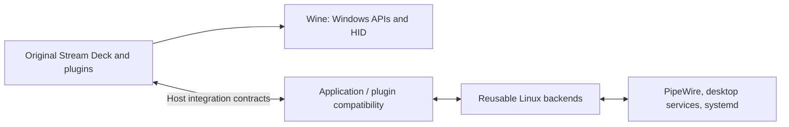

# Architecture

## Design approach

SDeckLinux implements compatibility at the interfaces used by Stream Deck and
its plugins. Target-facing contracts describe the expected calls, data and
lifecycle; native backends supply Linux behavior independently of those contracts.

The architectural reference is [AnyPS5](https://github.com/boykopovar/AnyPS5),
particularly its separation of executable conversion from native implementations
of target system libraries in [its architecture](https://github.com/boykopovar/AnyPS5/blob/main/docs/dev/ARCHITECTURE.md).
SDeckLinux applies the interface/implementation separation to its own domain:
Wine supplies Windows execution, while DeckBridge handles explicit host
integration boundaries. No executable relinking is implemented here.

## Layers and dependency direction



The diagram describes responsibilities; the exact transports are shown below.

| Layer | Ownership | Dependency rule |
| --- | --- | --- |
| Windows execution | Existing Wine installation and original vendor software | Preserve working behavior; audit a missing boundary before adding an implementation. |
| Application compatibility | `deckbridge/compat/sdeck/<service>/` | Stream Deck-specific URL, authorization and renderer integration; no plugin-specific wire fields. |
| Plugin compatibility | `deckbridge/compat/plugins/<plugin_name>/` | Exact plugin contracts, version checks and translations into reusable host operations. |
| Shared Windows compatibility | `deckbridge/compat/windows/` | Wine font-family fallback and bounded registry access; shared by consumers, without plugin wire fields. |
| Native implementations | `deckbridge/backends/<capability>/` | Linux models, service access and lifecycle; never import plugin contracts or expose vendor wire IDs. |
| Shared runtime | Configuration, IPC, process helpers and installation | Bounded transport, local policy and reversible deployment; no plugin behavior in generic IPC. |

Compatibility modules depend on host backends, never the reverse. A backend
models a host capability such as an audio stream; an adapter owns how that model
maps to a particular consumer's methods, units and identifiers. For example,
Volume Controller's synthetic `processID` belongs to its adapter, while PipeWire
server/stream identities belong to the audio backend.

Organize by the boundary being implemented, rather than assigning all audio code
to a plugin or calling every host operation a Windows API. Auto and Manual
Detection share the same native application model. A future consumer can reuse
that backend without importing Volume Controller's JSON-RPC names. If an actual
Windows API translation is required, place its ABI/COM contract under
`compat/windows/<api>/` and let it use the same backend; add that directory only
with a concrete implementation and consumer. A service contract shared by
plugins should likewise be named for that service, with plugin version checks
kept separate. Existing working Wine APIs remain Wine-owned.

## Adding compatibility

1. Identify the actual failing API or service boundary and the consumer version.
   Record the request/response types, units, error behavior and lifecycle without
   storing private payloads or credentials.
2. Check existing Wine behavior first. Reuse a host backend when the missing
   behavior is a Linux capability; isolate application- or plugin-specific
   translation in the corresponding compatibility directory.
3. Implement the required semantics, including notifications, disappearance and
   failure. Unsupported operations return explicit errors; success-only stubs
   do not establish compatibility.
4. Keep the integration individually switchable and installation reversible.
   Add hardware-free contract coverage for meaningful behavior, then use
   separately authorized host/device tests where needed.
5. Record implementation scope separately from functional acceptance. Update the
   application, basic-function or versioned-plugin compatibility entry only with
   observable evidence; startup alone is insufficient.

New shared API implementations require a demonstrated consumer. A generic Win32
shim or additional platform backend is not represented as implemented by an
empty directory or a speculative interface.

## Current boundaries

```text
Linux browser / explicit original Stream Deck Open action
  -> XDG streamdeck:// handler / Wine start /unix
  -> DeckBridge CLI (desktop URI ingress or named native target)
  -> v1 JSON-lines IPC over a same-user Unix socket
  -> systemd --user DeckBridge daemon
       -> Wine StreamDeck.exe URI handoff to the existing exact-prefix instance
       -> allowlisted native argv or URL through a transient systemd user service

Original Volume Controller 2.0.5.201 (unchanged Windows Node process)
  -> its existing Audio Router JSON-RPC WebSocket, 127.0.0.1:1844
  -> hash/version/prefix/process/socket-owner authenticated plugin adapter
  -> reusable host audio model
       -> event-driven pw-dump graph observations
       -> exact PipeWire-Pulse sink-input volume/mute commands
```

`StreamDeck.exe`, its SDK WebSockets, device handling and installed plugins remain
under Wine. Standard Wine remains the first compatibility provider. No DLL
overrides, plugin patches, SDK interception or replacement UI are added.
The existing launch environment (`WINEARCH=win64`, disabled `winemenubuilder`)
and prefix-local Liberation Sans font fix remain intact.

## Implemented components

| Component | Responsibility |
| --- | --- |
| `deckbridge.uri` | Shared URI/HTTP URL validation |
| `deckbridge.compat.sdeck.oauth` | Stream Deck URI validation, KDE ingress repair, exact-instance forwarding and scoped portal integration |
| `deckbridge.compat.sdeck.webview` | Built-in Wine launch defaults (software rendering, renderer sandbox off), with explicit local overrides |
| `deckbridge.compat.sdeck.webview.desktop` / `preferences` | Versioned installer menu ownership/restore plan and explicit WebEngine preference editing |
| `deckbridge.compat.sdeck.webview.native_renderer` | Build/hash-gated native surface preference, bounded registry backups, ownership journal, verified write and scoped restoration |
| `deckbridge.config` | Private v1 TOML, exact Wine paths, individually enabled mappings |
| `deckbridge.protocol` | Bounded typed request envelope and fixed error codes |
| `deckbridge.client` / `server` | Framing, peer UID, deadlines, disconnects and explicit reconnection |
| `deckbridge.wine` | Match executable plus `WINEPREFIX`; bounded helper lifecycle |
| `deckbridge.providers` | Capability discovery and native/OAuth/audio dispatch |
| `deckbridge.diagnostics` | Read-only component and HID visibility observations |
| `deckbridge.backends.audio` | Linux sessions, stable identities, grouping, graph changes and scoped per-stream control |
| `deckbridge.backends.audio.devices` | Native endpoint inventory, independent input/output gates, exact identity and verified balanced writes |
| `deckbridge.compat.windows.core_audio` | Experimental COM endpoint wrappers, Windows callbacks, Wine identity translation and bounded native RPC; production activation pending |
| `deckbridge.backends.desktop` | Bounded native named-icon lookup/rendering using existing system GI packages |
| `deckbridge.compat.plugins.volume_controller` | Observed vendor contract, process authentication, RPC and notifications |
| `tools/install.py` | Hash-tracked user integration and scoped MIME restoration |
| `make install` / `tools/setup.py` | Standard installation: existing-install detection, dependencies and automatic menu integration; no separate repair workflow |
| `tools/smoke.py` | Explicit real-host observations, excluded from `make check` |
| `tools/audio_smoke.py` | Opt-in silent null-sink fixture and separately authorized audio checks |
| `tools/prepare_runtime.py` | Hash-verified portable dependency preparation for the installer |

Python package directories use underscores (for example `volume_controller`).
Plugin fields never enter the host audio model. Modules were moved without
changing OAuth's public capability/CLI contract; the installer copies nested
packages and JSON contracts and removes only unchanged hash-owned obsolete files.

`oauth.deepLink` means transport for the complete URI, including application
callbacks. It reports `forwarded-unconfirmed`; this is not an OAuth completion
signal. Elgato's own single-instance mechanism is responsible for dispatch after
Wine starts the forwarding helper. A disappearing instance produces an error;
there remains a process-exit race between observation and launch.

KDE 6.7.5 `%u` was observed to decode `%20` and UTF-8 Unicode while preserving
reserved escapes. The desktop-only `handle-uri` command encodes those characters
again, preserving `%`, `+`, delimiters and existing escapes. It does not unquote
the URI. Exact original escape spelling for already decoded unreserved characters
cannot be recovered from KDE; semantic URI contents are preserved. The ordinary
`deep-link` CLI preserves its supplied encoded URI exactly.

## Security and lifecycle

The socket is `$XDG_RUNTIME_DIR/deckbridge/control.sock`, with directory `0700`,
socket `0600` and `SO_PEERCRED` UID validation. A held `flock` prevents a second
daemon from unlinking a live socket. Arbitrary pre-existing files and symlinks
are rejected. This is a same-user service boundary, not a sandbox against plugins
already running as that user under Wine.

Native targets and URLs are fixed in the
private local configuration; request payloads cannot supply commands, arguments,
desktop IDs or arbitrary URLs. Transient `Type=exec` user services avoid killing
native applications when DeckBridge stops. Environment expansion is disabled,
descriptions are fixed, and their standard output/error are discarded.

Logs contain fixed events/codes and server-generated correlation IDs, never URI
payloads or subprocess output. Validated method/capability names distinguish
diagnostics from real forwarding attempts. Core dumps are disabled for the installed service.
The original application may write received URLs into its own private logs;
DeckBridge does not control that logger. Do not collect those logs around real
OAuth flows without redaction. URI argv is also visible to same-user process
inspection, as with ordinary desktop protocol handlers.

The OpenURI portal has a separate remembered-application store. A correct MIME
default alone does not prove correct browser dispatch: the audited portal still
selected `streamdeck-wine`, whose desktop entry has no URL field code. Installation
replaces only remembered choices targeting that legacy launcher, using
`PermissionStore.SetPermission` for the `desktop-used-apps` /
`x-scheme-handler/streamdeck` entry. Previous per-caller values are saved before
mutation. Other callers' choices, use counters, thresholds, the opaque data
variant (including always-ask) and browser consent are retained. Deactivation
restores only choices still pointing to DeckBridge, preserving user changes.

No callbacks are automatically retried or queued. A disconnect/timeout can mean
the action already happened. Clients reconnect for a new explicit request; users
must restart an OAuth flow rather than replay an old authorization code.

## Audio boundary

The installed plugin's native addon uses standard Windows device APIs and already
enumerates Wine devices. Its application-session control instead calls a missing
Audio Router service over loopback WebSocket. A narrow, opt-in adapter implements
that observed service for exactly the pinned plugin build; it does not intercept
the Stream Deck SDK. See [ADR 0002](adr/0002-volume-controller-service-adapter.md)
for the Windows-API-first decision and transport tradeoffs.

The unchanged client sends no credential. Access requires the same UID, exact
Wine prefix, Node/script paths, SDK UUID/version and a kernel TCP socket inode
owned by that matching process. Browser Origins and unrelated native clients are
rejected. Plugin files must match the checked-in SHA256 contract. This is process
attribution, not a sandbox against a malicious process already controlling the
same user's account. No listener is opened unless both audio and this adapter
are explicitly enabled. A busy port or contract mismatch fails visibly; no
competing service is stopped.

PipeWire server cookie plus `object.serial` identifies a stream across node-ID
reuse. A logical application groups streams by Flatpak ID, application ID, or
binary fallback; reported PIDs are metadata, since Flatpak PIDs may be namespaced.
The application peak is the maximum member volume and its mute is true only when
all members are muted. A volume action sets each snapshot member's peak to the
requested scalar, preserving that member's channel balance. Before each action,
fresh server/serial/Pulse-handle identity is checked. Disappearance is an error;
multi-stream failure can report partial application and is never replayed.
There remains a small check/use race in external `pactl` control; no atomic
PipeWire transaction or persistent application policy is claimed.

`pw-dump --monitor` drives add/remove/volume/mute notifications to the original
plugin. A failed backend closes the adapter connection to avoid a stale UI and
reports a fixed diagnostic error; audio failure does not disable OAuth. The
original plugin owns reconnection. No background retry of audio mutations occurs.
Direct native streams without Pulse handles are read-only. Default-output
volume/mute has a separate `allow_system_write` gate, false by default. It
selects the current default's explicit sink handle and revalidates cookie,
serial/name/index and unchanged default immediately before control. It never
sets routing or uses a late-resolved `@DEFAULT_SINK@` target. The separate native
endpoint backend now implements input/output scalar and mute commands with
independent default-off gates. Ordinary original-addon launches still use Wine;
the experimental COM activation and its remaining gates are described in the
[Core Audio notes](compat/windows/core-audio.md).

Native icons are backend metadata, not plugin fields. A bounded worker uses
existing system-Python GI/GTK3/GdkPixbuf so the core daemon needs no new Python
package dependency. Only named icons/installed desktop metadata are read; no
desktop Exec is invoked. The adapter chooses PNG or its client's text fallback.
Filtering event-only streams applies to this plugin view, not the backend's
complete session inventory.

## Expansion boundaries

The contract uses capability names, versions and capability-specific arguments;
providers return fixed errors and distinguish transport acceptance from observed
behavior. Only implemented capabilities are advertised. Event subscriptions are
explicitly unavailable in v1; no polling bus or placeholder event framework exists.

Future providers must be based on observed needs:

| Capability family | Required boundary before implementation |
| --- | --- |
| `input.hotkey`, `input.text` | KDE RemoteDesktop/portal and libei consent, Unicode/layout semantics, modifier release |
| `clipboard.read/write` | Wayland selection ownership and explicit consent/privacy model |
| `media.player.control` | Actual MPRIS service capabilities and lifecycle |
| `applications.monitor`, `windows.observe` | KDE/Wayland visibility and permission constraints |

A generic Win32 shim requires real API tracing, correct ABI/architecture,
threading/reentrancy, COM lifetime where relevant, and comparison with current
Wine. The Stream Deck SDK is not a universal Windows API boundary. Per-plugin
adapters need an observed, versioned protocol and a selective switch.

Plugin compatibility evidence will be keyed by UUID **and version**, with states
`native-wine`, `generic-bridge`, `plugin-adapter`, `unsupported`, `untested`.
Launching alone is insufficient. Manifest metadata does not prove API dependencies.
There is no automatic telemetry upload.

## References

- [Elgato deep-link contract and passive callbacks](https://docs.elgato.com/streamdeck/sdk/v1/guides/deep-linking/).
- [Desktop Entry Exec field codes](https://specifications.freedesktop.org/desktop-entry/latest-single/).
- [systemd-run exec semantics](https://freedesktop.org/software/systemd/man/latest/systemd-run.html).
- [Linux hidraw identity ioctl](https://www.kernel.org/doc/html/latest/hid/hidraw.html).
- [Portal remembered-application store](https://github.com/flatpak/xdg-desktop-portal/wiki/The-Permission-Store).
- [Installed portal version's selection logic](https://github.com/flatpak/xdg-desktop-portal/blob/1.22.1/src/open-uri.c).
